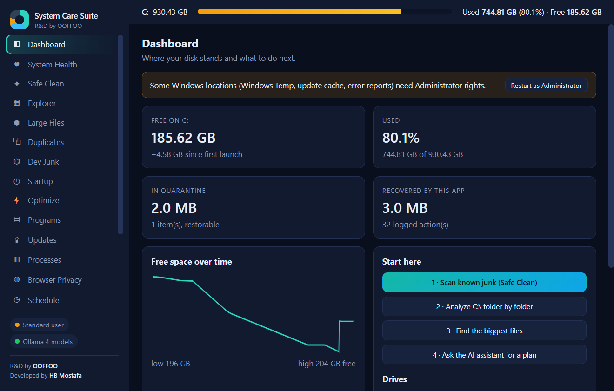
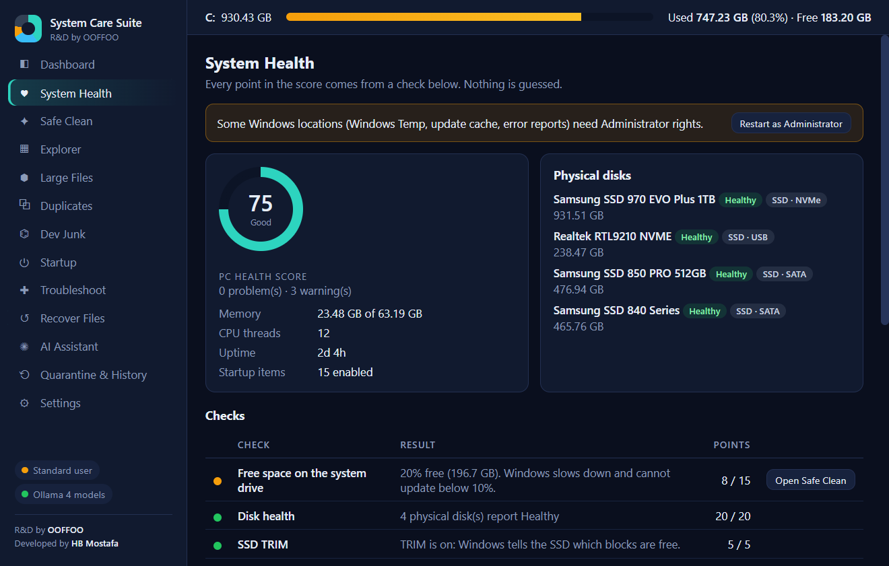

<div align="center">


# System Care Suite

**A free, open-source Windows PC cleaner and system care app that explains what it does before it does it.**

Free up disk space, tame startup, update your programs, repair Windows and get your files back. Every action is reversible or confirmed, and an optional local AI explains it in plain language, offline.

[](https://github.com/hasmeebd/system-care-suite/actions/workflows/ci.yml)
[](LICENSE)


[Why it exists](#why-another-pc-cleaner) · [Features](#features) · [Safety model](#how-it-keeps-your-pc-safe) · [Get started](#get-started) · [FAQ](#faq)



</div>

---

## Why another PC cleaner?

Most "PC optimizer" apps ask for trust they haven't earned. They delete things you can't get back, promise speed boosts they can't measure, clean the registry for no real gain, and phone home while they do it.

System Care Suite is built the other way round:

- **It shows its work.** Every health-score point comes from a named check. Every cleanup location shows its path, its size and what it is.
- **Nothing is final until you say so.** Deleted files go to a quarantine you can restore from (purged after 7 days by default). System settings it changes are saved first, so "undo" restores the exact old value.
- **No snake oil.** No registry cleaner, no "RAM booster", no fake antivirus, no "speed up your PC by 300%" claims. These are left out on purpose.
- **Private by design.** No account, no telemetry, no ads, no upsell. The AI assistant runs on your own machine through [Ollama](https://ollama.com), or not at all.
- **Small and fast.** A single ~12 MB native app written in Rust (Tauri 2). No Electron, no background service.

## Features

System Care Suite puts 18 tools in one window. Use only the ones you need.

### Free up disk space

| Tool | What it does |
| --- | --- |
| **Safe Clean** | Clears an allowlist of about 30 known cache and temp locations: Windows Temp, Windows Update downloads, Delivery Optimization, crash dumps and error reports, Chrome/Edge/Firefox caches, DirectX/NVIDIA/AMD shader caches, and pip/uv/npm/NuGet/Yarn caches. Riskier items (Windows.old, Cargo, Gradle, Unity, Hugging Face, Downloads) are marked *review* and never picked automatically. Browser cookies, history and passwords are not part of it. |
| **Explorer** | Folder-by-folder sizes measured as **real space on disk**. Sparse files, compressed files and cloud-only OneDrive placeholders are counted correctly. |
| **Large Files** | Your biggest files, with on-disk vs. logical size so you can tell a real 60 GB file from a sparse VM disk. |
| **Duplicates** | Finds byte-for-byte identical files: matched by size, then a quick fingerprint, then a full **BLAKE3** hash. Each removal is re-checked against the copy you keep, and at least one copy always stays. |
| **Dev Junk** | Built for developers. Finds regenerable `node_modules`, `.next`/`.nuxt`, Rust `target`, Python venvs, Unity `Library`, Unreal `DerivedDataCache`, Gradle, Flutter, .NET `bin`/`obj`, CocoaPods, Terraform and more. Every folder is verified against its manifest (`package.json`, `Cargo.toml`, `*.uproject`…) or `git check-ignore`, and the list shows each project's age and whether it has uncommitted changes. |
| **Schedule** | Automatic background cleaning through a normal Windows scheduled task, using only the safe targets you tick. No service is installed and no Administrator rights are needed. |

### Speed and startup

| Tool | What it does |
| --- | --- |
| **System Health** | A PC health score built from 8 visible checks: free space, disk health, SSD TRIM, startup load, uptime, pending restart, memory and antivirus. Plus TRIM, analyze and defrag (HDD only) per drive. |
| **Startup** | Turn startup apps on or off with the same switch Task Manager uses. Covers registry entries, Startup folders, logon tasks and third-party services. Fully reversible. |
| **Optimize** | Small, reversible Windows tweaks, each explained (the original value is restored on undo). Also a power-plan switch, hibernation off (frees `hiberfil.sys`), one-click restore point, and removal of preinstalled Store apps from a fixed list, all reinstallable from the Store. |
| **Processes** | A live view of what's running, by memory and CPU. Ending a program is always one explicit, confirmed click. |

### Keep programs up to date

| Tool | What it does |
| --- | --- |
| **Updates** | Lists outdated programs through **winget** (Microsoft's package manager) and updates selected ones, or all of them, with live output. It also detects a broken IPv6 route to Microsoft's servers, a common cause of winget hanging forever, and fixes it automatically. |
| **Programs** | Every installed program with size and install date, uninstalled through its own uninstaller (silently when the program supports it). |

### Repair and recover

| Tool | What it does |
| --- | --- |
| **Troubleshoot** | One-click, explained Windows repairs with live output and cancel: `sfc`, DISM check/scan/repair, `chkdsk` online scan, flush DNS, renew IP, prefer IPv4, Winsock and TCP/IP reset, Windows Update reset, Store cache reset, icon cache rebuild, stuck print queue, clock resync, restore point. |
| **Diagnostics** | Critical and error events from the Windows event log, grouped so repeating problems stand out. Read-only. |
| **Recover Files** | Restore from the Recycle Bin, or copy older copies of files out of **Previous Versions** (Volume Shadow Copies) without overwriting anything. |
| **Quarantine & History** | Everything removed through the app waits here for undo, and every action is logged. |

### Privacy

| Tool | What it does |
| --- | --- |
| **Browser Privacy** | Clears cookies and browsing history for Chrome, Edge, Brave and Firefox. The files go to quarantine first, so a mistake is one click to undo. |

### Optional local AI assistant

Connect a local [Ollama](https://ollama.com) model (Llama, Qwen, Gemma, DeepSeek and others) and ask things like *"what is eating my C: drive?"* or *"is this startup item safe to disable?"*. The assistant reads the app's scan results and explains them in plain language. Models with a "thinking" mode are detected automatically.

The AI **cannot delete, move or change anything**. It has no access to those functions at all. Every suggestion still needs your click and passes the same safety rules as everything else. No cloud, no API key, nothing leaves your PC.

<div align="center">

</div>

## How it keeps your PC safe

Safety is enforced in Rust, below the UI, so no button, setting or AI answer can get around it:

1. **Allowlists, not guesses.** The cleaner can only touch locations defined in code. The UI sends an id, never a path or a command, and the same goes for repairs and tweaks.
2. **Protected paths.** Windows, Program Files and other system locations are refused, as are any folders you add in Settings. Paths are normalized and resolved first (`..`, short 8.3 names, symlinks, junctions), so tricks like `C:\Windows\..\Windows` don't get past the check.
3. **Quarantine by default.** Deletions are moved, not erased. Restore them any time until they're purged (7 days by default, configurable). Permanent delete is a deliberate choice.
4. **Undo for settings.** Tweaks save the original registry value and put it back exactly. Startup items are disabled, never deleted.
5. **No shell injection.** Programs are run with separate, validated arguments (winget package ids are checked against a strict character set), never through a command string built from input.
6. **Administrator only when needed.** The app runs as a normal user. A few system locations and repairs ask you to restart as Administrator, and they say why.

## Get started

### Requirements

- Windows 11 or Windows 10 (64-bit). Developed and tested on Windows 11.
- Microsoft Edge WebView2, which comes with Windows 11 and current Windows 10.
- *Optional:* [Ollama](https://ollama.com) with any chat model, for the AI assistant.
- *Optional:* winget ("App Installer" from the Microsoft Store), for Updates. It's preinstalled on Windows 11.

### Install

1. Download `System-Care-Suite.exe` from the [**latest release**](https://github.com/hasmeebd/system-care-suite/releases/latest).
2. Run it. It's portable: one file, no installer. Settings live in `%LOCALAPPDATA%\CDriveStudio`.
3. Start on the **Dashboard** and follow *Start here*: Safe Clean → Explorer → Large Files → ask the AI for a plan.

> Windows SmartScreen may warn about an unsigned app from a new publisher. Click **More info → Run anyway**, or build it yourself from source (below) if you prefer.

### Build from source

You need [Rust](https://rustup.rs) (MSVC toolchain; the repo pins the version in `rust-toolchain.toml`) and the Visual Studio C++ Build Tools.

```powershell
git clone https://github.com/hasmeebd/system-care-suite.git
cd system-care-suite
.\build.ps1          # builds and copies the app to .\dist\System-Care-Suite.exe
```

Or double-click `Build-And-Run.bat`. To build by hand: `cd src-tauri` then `cargo build --release --locked`.

## Who it's for

- **Everyday Windows users** who want a cleaner they can trust, without ads, nagging or a subscription.
- **Developers** whose drives fill up with `node_modules`, `target` folders, venvs and package caches.
- **Gamers and creators** chasing space taken by shader caches, crash dumps, old updates and duplicate media.
- **AI hobbyists** who want to see how much space Ollama models and Hugging Face caches use, and get local-AI help on top.
- **The "family IT person"** who needs safe, explainable repairs (`sfc`, DISM, network resets) without typing commands.

## FAQ

<details>
<summary><b>Is it safe to use? Can it break Windows?</b></summary>

It is designed so it can't. It only touches known cache and temp locations, refuses system folders, quarantines instead of deleting, and saves the original value of every setting it changes. See [How it keeps your PC safe](#how-it-keeps-your-pc-safe).
</details>

<details>
<summary><b>Does it need the internet or send any data?</b></summary>

No. There's no telemetry, no account and no update check. The only network connections are the ones you start: winget when you check or install program updates, and Ollama, which runs on your own PC (`127.0.0.1:11434` by default).
</details>

<details>
<summary><b>Is it free?</b></summary>

Yes. It's free and open source under the MIT license, with no "Pro" version and no feature locked behind a payment.
</details>

<details>
<summary><b>Why is there no registry cleaner or RAM booster?</b></summary>

They don't make a modern Windows PC faster and can cause real problems. Freeing RAM just makes Windows reload it, and registry "errors" cost nothing. System Care Suite focuses on things that measurably help: disk space, startup load, updates and repairs.
</details>

<details>
<summary><b>Do I need the AI assistant?</b></summary>

No. Every tool works without it. The AI only explains and suggests, and it runs locally through Ollama if you choose to install it.
</details>

<details>
<summary><b>Why do some items need Administrator?</b></summary>

Windows protects system-wide locations (Windows Temp, the update cache, error reports) and repairs like `sfc` and DISM. The app tells you when something needs it and offers to restart as Administrator. Everything else runs as a normal user.
</details>

<details>
<summary><b>Why does my folder total look bigger than the drive's used space?</b></summary>

Sizes are real space on disk. Hard-linked files (Windows components, uv/pip caches) can appear in more than one folder, so a sum of folders can slightly exceed the used space on the drive.
</details>

## Under the hood

- **Rust** back end: file scanning with `rayon`, hashing with `BLAKE3`, Windows APIs through `windows-sys`, registry access through `winreg`.
- **Tauri 2** shell with a plain HTML/CSS/JavaScript UI (no framework, no bundler).
- **Ollama** HTTP API for the local assistant, with streaming and thinking-model support.
- Built-in Windows tools (winget, `sfc`, DISM, `netsh`, Task Scheduler, Volume Shadow Copy) driven through an allowlist with live output.

```
src-tauri/src/   Rust back end: one module per tool (hogs, devjunk, dupes, startup, tweaks, updater, recover, ...)
ui/              Front end: index.html, app.js, style.css
```

## Contributing

Bug reports, feature ideas and pull requests are welcome. [Open an issue](https://github.com/hasmeebd/system-care-suite/issues) to start a discussion. A good bug report includes your Windows version, the page you were on and the message you saw.

If System Care Suite saved you some space or a reinstall, a ⭐ on GitHub helps other people find it.

## License

[MIT](LICENSE). Free to use, modify and share.

---

<div align="center">

**System Care Suite** · R&D by **OOFFOO** · Developed by **HB Mostafa**

<sub>Windows disk cleaner · free up disk space · PC optimizer alternative · startup manager · duplicate file finder · winget updater · Windows repair tool · local AI assistant · open source</sub>

</div>
